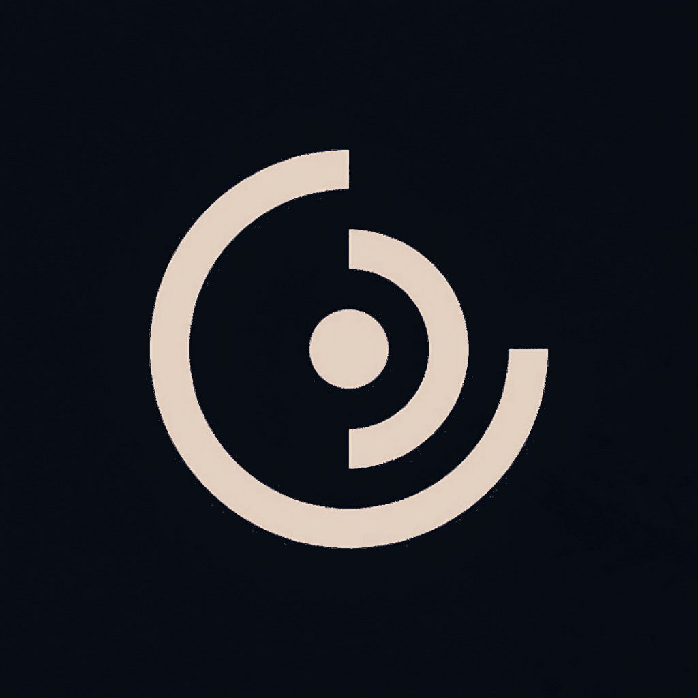

<div align="center">



# Onyx Browser

A fast, privacy-focused Android browser with native Rust content blocking and a built-in userscript engine.

[](https://github.com/abidhasansojib/onyx-browser/actions/workflows/build.yml)
[](https://github.com/abidhasansojib/onyx-browser/releases/latest)
[](https://developer.android.com)
[](LICENSE)

[**Download APK**](https://github.com/abidhasansojib/onyx-browser/releases/latest) • [**Features**](docs/FEATURES.md) • [**Architecture**](docs/ARCHITECTURE.md) • [**WebView Guide**](docs/WEBVIEW.md) • [**Contributing**](CONTRIBUTING.md) • [**Security**](SECURITY.md)

</div>

---

## Key Capabilities

- **Native Content Blocking** — Powered by Brave's `adblock-rust` (`libadblock_bridge.so`) with 54 filter lists, FlatBuffers binary caching, CNAME uncloaking, cosmetic/procedural filtering, and scriptlet injection.
- **Userscript Engine** — Tampermonkey and Violentmonkey compatibility with document-start injection, `@inject-into` / `@sandbox` isolation, first-use `@connect` prompts, full `GM_*` / `GM.*` APIs, and a 120 FPS code editor.
- **Background Media & PiP** — Uninterrupted background audio/video playback, lockscreen controls, and automatic Picture-in-Picture across inline and fullscreen video.
- **Privacy & Security** — SQLCipher AES-256 encrypted Room database, Chromium `ProfileStore` multi-profile incognito isolation, WebAuthn Level 3 passkeys, DNS-over-HTTPS, and granular clear-on-exit.
- **Modern UI** — Jetpack Compose and Material 3 screens (`OnyxTheme`) paired with a low-overhead ViewBinding WebView host, customizable top/bottom address bar, and Light/Dark/AMOLED themes.

---

## Download

Download the latest signed APK from [**GitHub Releases**](https://github.com/abidhasansojib/onyx-browser/releases/latest):

| Variant | Target Devices |
| :--- | :--- |
| `arm64-v8a` | Modern 64-bit ARM devices (Recommended) |
| `armeabi-v7a` | Legacy 32-bit ARM devices |
| `x86_64` | 64-bit x86 emulators and Chromebooks |
| `universal` | All architectures in a single APK |

---

## Tech Stack

- **UI**: Jetpack Compose (Material 3, Compose BOM `2024.10.01`, Kotlin 2.0.21) for screens, dialogs, and sheets; XML ViewBinding for `MainActivity` WebView and camera hosting.
- **Engine**: Android System WebView + AndroidX WebKit (`Multi-Profile`, `DocumentStartJavaScript`, `WebMessageListener`, `UserAgentMetadata`).
- **Native Core**: Rust NDK (`adblock-rust` -> `libadblock_bridge.so`) with JNI bridge (`AdBlockEngine`).
- **Storage**: SQLCipher AES-256 encrypted Room (`AppDatabase`) backed by Android KeyStore.
- **Background Work**: AndroidX WorkManager (`UpdateScheduler`) for 12-hour app, filter list, and userscript update checks.

---

## Building from Source

### Local Workstation (Linux / macOS / WSL2)

Requires **JDK 17**, **Android SDK (API 35)**, **Android NDK r26b+**, and **Rust stable** with `cargo-ndk`.

```bash
git clone --recurse-submodules https://github.com/abidhasansojib/onyx-browser.git
cd onyx-browser
./scripts/bootstrap_dev.sh
./gradlew :core:common:test testReleaseUnitTest assembleRelease
```

### GitHub Actions CI

1. Fork the repository on GitHub.
2. Open **Actions -> Build Onyx Browser** and click **Run workflow**.
3. Select `Release` or `Prerelease` to build signed APKs and publish a GitHub Release.

See [CONTRIBUTING.md](CONTRIBUTING.md) for development guidelines and architecture details.

---

## License

Licensed under the [GNU General Public License v3.0 (GPL-3.0)](LICENSE).
